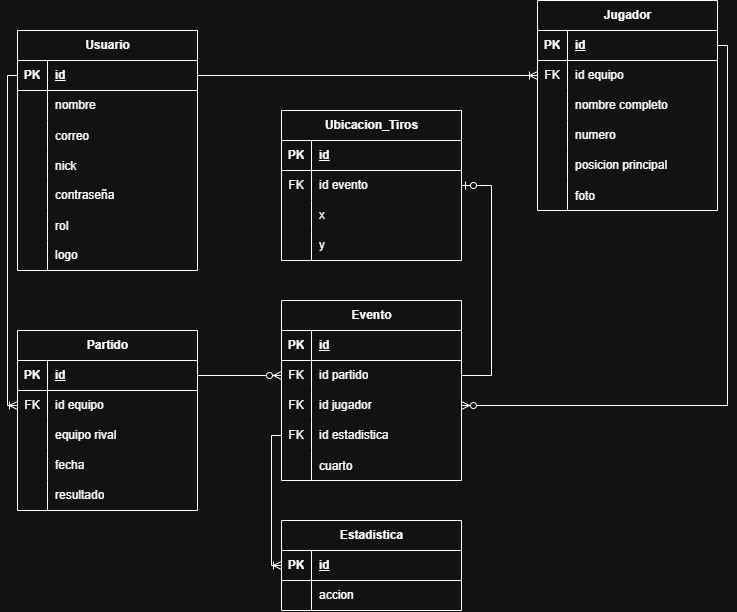

# BasStats — Sistema Web MVC de Gestión y Estadísticas de Básquetbol

[](https://www.typescriptlang.org/)
[](https://nodejs.org/)
[](https://expressjs.com/)
[](https://react.dev/)
[](https://www.postgresql.org/)
[](https://orm.drizzle.team/)

---

## 🏀 Descripción General y Problema que Resuelve

En el ámbito del básquetbol amateur y semiprofesional, los clubes y entrenadores suelen registrar las planillas de juego en papel o planillas de cálculo aisladas, lo que dificulta el seguimiento de rendimiento, la generación de mapas de calor de tiro (*shot charts*) y el control unificado de planteles.

**BasStats** es un sistema web fullstack con **arquitectura MVC (Modelo - Vista - Controlador)** que digitaliza integralmente la gestión deportiva:
1. Permite a los **Equipos** registrar y gestionar su plantel de jugadores, configurar quintetos titulares y registrar estadísticas en vivo mediante una cancha interactiva con coordenadas de tiro (*x, y*).
2. Permite al **Administrador de Liga** auditar métricas globales, gestionar usuarios, otorgar/revocar permisos de rol y dar de baja equipos de forma centralizada.
3. Provee una **Web API REST autenticada con JWT** y paginación por servidor para garantizar alta eficiencia y escalabilidad.

---

## 🏛️ Arquitectura del Sistema (MVC Desacoplado)

El proyecto implementa el patrón **Modelo - Vista - Controlador (Decoupled / Distributed MVC)**, separando la lógica de negocio y persistencia de la interfaz reactiva:

```
┌────────────────────────────────────────────────────────┐
│                   VISTA (View)                         │
│  React 18 + TypeScript + Vite + TailwindCSS (SPA)      │
│  - ABM reactivo sin recarga de página                  │
│  - Búsqueda asíncrona AJAX con debounce                │
│  - Consola de partido interactiva (Canvas / Court)     │
└──────────────────────────┬─────────────────────────────┘
                           │ Peticiones AJAX / JSON
                           │ Headers: Authorization Bearer <JWT>
┌──────────────────────────▼─────────────────────────────┐
│                CONTROLADOR (Controller)                │
│  Express.js + TypeScript (basstats-api)                │
│  - AuthController, AdminController, JugadorController  │
│  - PartidoController, EventoController                 │
│  - Middlewares: JWT Authentication & Role Authorization│
└──────────────────────────┬─────────────────────────────┘
                           │ Llamadas a Modelos SQL (Drizzle ORM)
┌──────────────────────────▼─────────────────────────────┐
│                   MODELO (Model)                       │
│  Drizzle ORM SQL Models + PostgreSQL 16                │
│  - UsuarioModel, JugadorModel, PartidoModel            │
│  - EstadisticaModel, EventoModel, UbicacionTiroModel   │
│  - Paginado Server-Side (LIMIT / OFFSET)               │
└────────────────────────────────────────────────────────┘
```

* **Modelo (M):** Definido en `basstats-api/src/models/` y `src/db/schema/`, estructurando entidades, comandos SQL de Drizzle ORM y validaciones con esquemas Zod.
* **Controlador (C):** Implementado en `basstats-api/src/controllers/`, procesa las solicitudes HTTP, aplica seguridad por roles y ejecuta los métodos del Modelo.
* **Vista (V):** Desarrollada en `basstats-web/src/pages/` y `src/components/`, interfaz SPA reactiva que consume la API vía `fetch`/AJAX sin recargar la página.

---

## 🗄️ Modelo de Datos y Diagrama Entidad-Relación (DER)

El sistema cuenta con **6 entidades principales fuertemente vinculadas**, incluyendo relaciones 1:N y la entidad dependiente `Evento` que vincula de forma ternaria a `Partido`, `Jugador` y `Estadistica`, complementada con `Ubicacion_Tiros`:



### Entidades del Modelo:
1. **`usuarios`**: Almacena credenciales con hash `bcrypt`, nick, avatar (`logo`) y `rol` (`'Administrador'` o `'Equipo'`).
2. **`jugadores`**: Pertenece a un usuario/equipo (1:N). Registra dorsal, posición y foto de perfil en servidor.
3. **`partidos`**: Disputado por un equipo contra un rival (1:N), fecha y resultado final.
4. **`estadisticas`**: Catálogo maestro de acciones del juego (Triples, Dobles, Libres, Faltas, Asistencias, Robos).
5. **`eventos`**: Entidad asociativa/dependiente que vincula `Partido + Jugador + Estadistica` con el cuarto en curso.
6. **`ubicacion_tiros`**: Coordenadas espaciales porcentuales `(x, y)` sobre la cancha interactiva vinculadas al evento de tiro.

---

## 📋 Matriz de Evidencias de Requerimientos Mínimos

A continuación se detalla el cumplimiento estricto de cada uno de los requerimientos exigidos por la cátedra para la condición de **PROMOCIÓN**:

| Requerimiento Mínimo | Estado | Archivos de Código / Controladores | Descripción de la Evidencia |
| :--- | :---: | :--- | :--- |
| **1. 6 Tablas y Relaciones (1:N y Dependiente)** |  Cumplido | [usuarios.ts](basstats-api/src/db/schema/usuarios.ts)<br>[jugadores.ts](basstats-api/src/db/schema/jugadores.ts)<br>[partidos.ts](basstats-api/src/db/schema/partidos.ts)<br>[eventos.ts](basstats-api/src/db/schema/eventos.ts)<br>[seed.sql](seed.sql) | 6 tablas en PostgreSQL: `usuarios`, `jugadores`, `partidos`, `estadisticas`, `eventos`, `ubicacion_tiros`. DER documentado en `/docs/der.png`. |
| **2. Login, Roles y Avatar** |  Cumplido | [auth.controller.ts](basstats-api/src/controllers/auth.controller.ts)<br>[auth.middleware.ts](basstats-api/src/middlewares/auth.middleware.ts)<br>[admin.controller.ts](basstats-api/src/controllers/admin.controller.ts)<br>[AuthContext.tsx](basstats-web/src/context/AuthContext.tsx) | Autenticación JWT con bcrypt. Manejo de roles `Administrador` y `Equipo`. Panel Admin exclusivo para cambio de roles y baja de equipos. Gestión y subida de Avatar de usuario en perfil. |
| **3. Manejo de Archivos en Servidor** |  Cumplido | [cloudinary.ts](basstats-api/src/config/cloudinary.ts)<br>[upload.middleware.ts](basstats-api/src/middlewares/upload.middleware.ts)<br>[TeamPage.tsx](basstats-web/src/pages/TeamPage.tsx) | Subida de imágenes multipart con Multer y almacenamiento directo en servidor Cloudinary para el Avatar de usuario y la Foto del jugador (`foto`). |
| **4. ABM Reactivo (SPA / AJAX sin recarga)** |  Cumplido | [TeamPage.tsx](basstats-web/src/pages/TeamPage.tsx)<br>[jugador.controller.ts](basstats-api/src/controllers/jugador.controller.ts) | CRUD completo de Jugadores (Alta con foto, Modificación, Baja y Listado) resuelto 100% vía AJAX/JSON en tiempo real sin recargar la página. |
| **5. Paginado por Servidor (Server-Side Pagination)** |  Cumplido | [usuario.model.ts](basstats-api/src/models/usuario.model.ts)<br>[jugador.model.ts](basstats-api/src/models/jugador.model.ts)<br>[partido.model.ts](basstats-api/src/models/partido.model.ts)<br>[PaginationControl.tsx](basstats-web/src/components/common/PaginationControl.tsx) | Listados de Usuarios, Jugadores y Partidos paginados desde backend con `page` y `limit`, retornando metadatos `{ total, totalPages, page }`. |
| **6. Búsqueda Asíncrona de Entidades (AJAX)** |  Cumplido | [UsuarioController.ts](basstats-api/src/controllers/usuario.controller.ts#L6)<br>[JugadorController.ts](basstats-api/src/controllers/jugador.controller.ts#L29)<br>[AsyncSearchSelect.tsx](basstats-web/src/components/common/AsyncSearchSelect.tsx)<br>[AdminPage.tsx](basstats-web/src/pages/AdminPage.tsx#L85) | Búsqueda asíncrona en servidor con debounce de 300ms en el panel de administración. Prohibido `<select>` masivo: las entidades se consultan dinámicamente vía AJAX. |
| **7. Web API REST con JWT & Colección de Pruebas** |  Cumplido | [auth.routes.ts](basstats-api/src/routes/auth.routes.ts)<br>[admin.routes.ts](basstats-api/src/routes/admin.routes.ts)<br>[Colección Bruno](/docs/bruno) | Endpoints REST protegidos por Bearer Token JWT. Colección de pruebas Bruno completamente configurada con assertions y variables de entorno en `/docs/bruno`. |

---

## 🔑 Credenciales de Prueba (Para Evaluación y Defensa)

El script de inicialización (`seed.sql` / `npm run db:seed`) incluye cuentas preconfiguradas con contraseñas hasheadas en `bcrypt`:

| Rol | Correo Electrónico | Contraseña | Permisos y Alcance |
| :--- | :--- | :--- | :--- |
| **Administrador** | `admin@basstats.com` | `Admin123!` | Acceso total al **Panel de Administrador (`/admin`)**, cambio de roles, baja de equipos, catálogo de estadísticas y auditoría del sistema. |
| **Equipo (Cóndores)** | `condores@basstats.com` | `Equipo123!` | Acceso a gestión de su propio plantel (`/team`), planilla de partido en vivo (`/match/live`) e historial de encuentros. |
| **Equipo (Vikingos)** | `vikingos@basstats.com` | `Equipo123!` | Acceso a su equipo y registro de partidos propios. |

> [!TIP]
> En la pantalla de login (`/login`), se incorporaron botones de **Acceso Rápido en 1 Clic** para alternar instantáneamente entre el Administrador y los Equipos durante la defensa oral.

---

## 🚀 Guía de Ejecución Local Paso a Paso

### Prerrequisitos
* Node.js v18 o superior
* Docker Desktop (para la base de datos PostgreSQL)

### 1. Iniciar Base de Datos PostgreSQL
Desde la carpeta raíz del proyecto:
```bash
cd basstats-api
docker compose up -d
```
*El contenedor PostgreSQL iniciará automáticamente en el puerto `5433` (mapeado a `5432` interno) con la base `basstats_db`.*

### 2. Poblar la Base de Datos con Datos de Prueba
Ejecutar el script de seed automático:
```bash
npm run db:seed
```
*O si prefieres ejecutar directamente el archivo SQL:*
```bash
Get-Content ../seed.sql -Raw | docker exec -i pg_basstats psql -U usuario -d basstats_db
```

### 3. Iniciar el Backend (Express API)
```bash
npm run dev
```
*El backend quedará escuchando en `http://localhost:3000`.*

### 4. Iniciar el Frontend (React SPA)
En una nueva terminal:
```bash
cd ../basstats-web
npm run dev
```
*La aplicación web estará disponible en `http://localhost:5173`.*

---

## 🧪 Pruebas de la Web API con Bruno

La colección completa de peticiones HTTP para probar la Web API con autenticación JWT se encuentra en:
📁 **[`/docs/bruno`](docs/bruno)**

### Pasos para probar con Bruno:
1. Descargar e instalar [Bruno](https://www.usebruno.com/).
2. Seleccionar **Open Collection** y abrir la carpeta `docs/bruno`.
3. Seleccionar el entorno **Local** (`baseUrl: http://localhost:3000/api`).
4. Ejecutar la petición `01 - Auth / 01 - Login Admin`: el token JWT se guardará automáticamente en las variables del entorno.
5. Ejecutar peticiones protegidas (`05 - Admin`, `02 - Jugadores (Paginado)`, `04 - Eventos con Coordenadas`).
